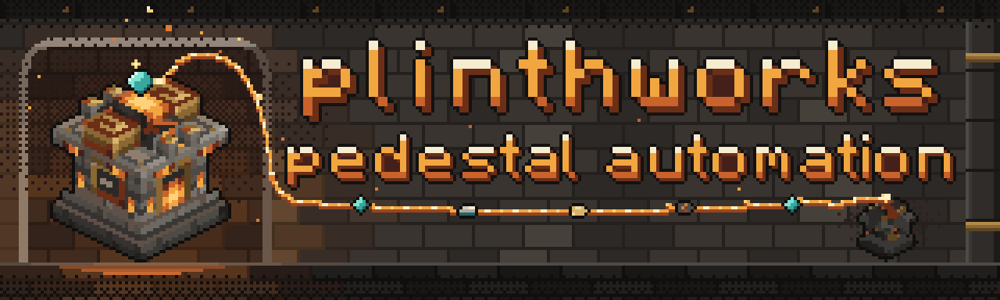
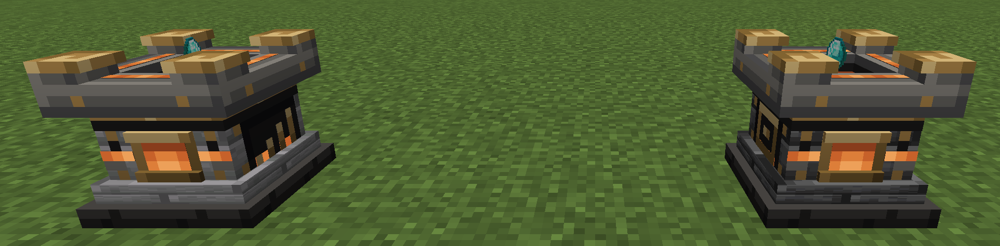
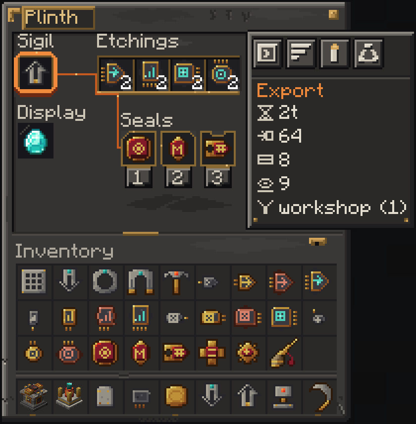

[](https://discord.gg/ZmmtPNJUcK)
[](https://github.com/cinderworks-mc/plinthworks/releases)
[](https://github.com/cinderworks-mc/plinthworks/actions/workflows/build.yml)


# plinthworks

pedestals you can teach to do things. slot in a sigil to import or export items, energy, fluids and xp, add filters and upgrades, and link plinths together.

each plinth has one screen for its sigil, etchings, seals and network. you can see what it is moving and change its setup without carrying a set of single purpose tools.

neoforge 1.21.1. the source, the issue tracker and the releases live here.



## what a plinth is

a plinth is a block that holds a small buffer and runs one sigil. the sigil decides what it does. etchings change how fast, how much and how far. seals decide what it is allowed to touch.

a plinth wears the block it is crafted from. put one plinth core and four of the same base block in the crafting grid and you get a plinth that looks like that block. bases are listed in the `plinthworks:plinth_bases` tag (stone, cobblestone, bricks, sandstone, deepslate, blackstone, quartz, purpur and a few more).

the plinth core is made from an iron ingot and three stone slabs. the other parts are shapeless recipes built on a blank sigil, blank seal or blank etching. look them up in your recipe viewer or in `src/generated/resources/data/plinthworks/recipe`.

## resource modes

a plinth moves one kind of resource at a time. cycle the mode in the screen.

- items. the default.
- energy. moves fe between neighbouring blocks that expose it.
- fluid. moves fluids between tanks.
- experience. moves xp as a fluid. neoforge has no xp fluid of its own, so this only works when another mod supplies one. the default list in the config names create enchantment industry's experience fluid and the `c:experience` and `forge:experience` tags. with no such mod installed, this mode has nothing to move.
- essentia. only there when thaumaturge is installed. a plinth holds one aspect at a time and reaches a warded jar through its top, so it works on a jar, beside one or across a range etching. import drains jars, export fills them, a linked pair moves essentia jar to jar. essentia that leaves a plinth any other way (the void sigil, breaking the plinth) turns into flux, the way thaumaturge handles spilled essentia.

## sigils

the sigil in the plinth decides what it does.

- import. pulls resources from nearby blocks into the plinth.
- export. pushes the plinth's buffer into nearby blocks.
- void. deletes what is in the plinth's own buffer. it never touches nearby containers. add seals to destroy only some things.
- magnet. collects dropped items into nearby storage.
- breaker. breaks blocks in its area and sends the drops to nearby storage.
- placer. places blocks it pulls from nearby storage.
- planter. plants seeds and saplings from nearby storage.
- harvester. harvests mature crops and replants.
- crafting. crafts the displayed item from nearby ingredients. it is off by default because of a duplication risk while that path is reworked. turn it on with `crafting.enabled`.

### world verbs

breaker, placer, planter, harvester and magnet act on the cube around the plinth, sized by the range etching. they run through a fake player and fire the normal break events, so land claim mods can veto them. plinths and bedrock are never broken, and block entities are skipped unless you turn on `world.verbs.breakBlockEntities`. a verb skips a block instead of spilling its drops when there is nowhere to put them.

## etchings

etchings are upgrades. there are four kinds and each has four tiers.

- speed. shorter delay between operations.
- capacity. more resources per operation.
- storage. a bigger buffer.
- range. a bigger search and linking reach.

the tier is shown in the item name (tier i to tier iv) and in its tooltip. a plinth has four etching slots by default.

each etching is a blank etching plus one ingredient: redstone for speed, a chest for capacity, a barrel for storage and an ender pearl for range. every tier up is the tier below plus the same ingredient again.

## seals

seals filter what a plinth is allowed to move. a plinth has three seal slots by default, and each seal can be a whitelist or a blacklist.

- item. matches an item and ignores its components.
- exact. matches an item and all of its components.
- mod. matches every item from one mod.
- tag. matches the items in a tag.
- component. matches a selected item component.

item, exact and mod seals have a ghost slot editor. drop an item in to add a key.

## channels and the link tool

plinths can be linked into a channel, so a plinth can pass resources to a plinth far away.

- use the link tool on a plinth to bind it. name the tool in an anvil to name the channel.
- use it on another plinth within link range (24 blocks by default, same dimension) to join that channel.
- sneak and use it on a plinth to clear the binding.
- the network screen lists the members of a channel and lets you rename it.

transfer modes decide how a channel shares work: priority, round robin or load balanced.

redstone modes: always runs, pause when powered, or run only when powered.

## the screen

everything is on one screen: the sigil, etchings, seals, the display slot or gauge, the resource, transfer and redstone buttons, and a stat panel with the rate, move amount, buffer and reach. seal settings and the network overview open from it.



## config

the config file is `config/plinthworks-common.toml`. some of the settings you may want to change.

- `speed`, `capacity`, `storage` and `range` set the base value, the step per tier and the cap for each etching.
- `etchings.slots` and `seals.slots` set how many slots a plinth has.
- `link.range` is how far apart linked plinths can be.
- `world.verbs.fireBlockEvents` fires break events through a fake player. it is on by default.
- `world.verbs.breakBlockEntities`, `requireFilter` and `blockBlocklist` control what the breaker is allowed to break.
- `energy` and `fluid` set buffer sizes and throughput.
- `xp.fluids` and `xp.mbPerPoint` set which fluid counts as experience and how much of it makes one point.
- `crafting.enabled` turns the crafting sigil on.
- `essentia` sets the essentia buffer and throughput in points, and `essentia.fluxOnBreak` decides whether a broken plinth releases its essentia as flux or keeps it on the dropped plinth.

## requirements and install

- minecraft 1.21.1
- neoforge 21.1.x
- java 21

put the jar in your `mods` folder on the server and on every client. jei, emi and create are optional. plinthworks does not add recipe pages or kinetic support for them yet. thaumaturge (1.0.2 or newer) is optional too and adds the essentia mode.

## building

you need java 21. gradle fetches the rest.

```sh
./gradlew build
./gradlew test
./gradlew runGameTestServer
```

the gametests live in `src/gametest` and are not part of the jar. see [CONTRIBUTING.md](.github/CONTRIBUTING.md) for more.

### building with the thaumaturge compat

the essentia mode needs a small compat in `src/thaumaturge` that compiles against thaumaturge itself. thaumaturge has no 1.21.1 maven and we can't host its jar, so bring your own: put `thaumaturge-1.21.1-NeoForge-1.0.3.jar` in `libs/` or pass `-Pthaumaturge_jar=/path/to/it`. without it the build says so and leaves the compat out, and everything else builds and runs the same. the jar is only compiled against, it never goes into ours. details in [libs/README.md](libs/README.md).

## where it came from

plinthworks is inspired by mowmaster's [pedestals](https://github.com/Mowmaster/Pedestals). it is an unofficial, separate mod written from scratch with its own code and art, and it is not affiliated with mowmaster. the biggest change is the interface: setup and inspection happen on one screen.

## planned

more sigils for quarrying and smelting, plus infusions: permanent upgrades etched onto a sigil.

## reporting issues

use the issue forms: bug, feature request, or compat report. include your plinthworks and neoforge versions and a crash log if there is one. security problems go through the private report link in [SECURITY.md](.github/SECURITY.md).

## help with the art

we'd love help on the art: blocks, items, the gui, textures and models. if you want to pitch in, come say hi in the [discord](https://discord.gg/ZmmtPNJUcK) or open an issue. you don't need to have shipped a mod before.

## licence

code is mit, see [LICENSE](LICENSE). there is no separate licence file for the art, so the source files in `art-source` and the textures made from them are under the same mit licence. see [THIRD_PARTY.md](THIRD_PARTY.md) for the notes on minecraft and neoforge.

plinthworks is not an official minecraft product. it is not approved by or associated with mojang or microsoft.
